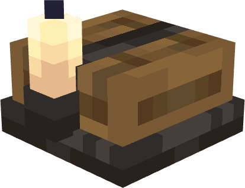
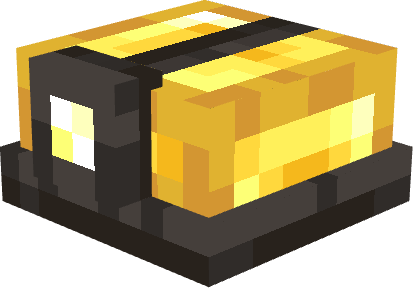

<p align="center">
  
</p>

<p align="center">
  <b>Caves deserve more.</b><br>
  A NeoForge mod that makes going underground in Minecraft feel alive, dangerous and worth the trip.
</p>

<p align="center">
  
  
  
</p>

---

## About

Caves & Cliffs gave Minecraft huge caves, but most of them still feel the same once you're down there. **Spelunker's Charm** fills the underground with things to find, things to fear and things to use: cracked-open boulders full of ore, geysers that erupt under your feet, tremors that shake rocks loose from the ceiling, a spider-infested cave biome, and helmets to light the way.

Everything is built to sit alongside vanilla and other mods. Features place themselves across every Overworld biome (modded ones included) and filter themselves where they don't fit, and most of them can be switched off in the config.

## Features

### 🪨 Boulders


Huge 3×3×3 boulders sit on cave floors. Crack one open and you might find a jackpot of **raw iron**, **raw copper** or **raw gold** at its core, or nothing but stone.

- **Lush boulders**, wrapped in moss, show up in lush and jungle caves.
- Boulders obey gravity. Mine out what's under one and it **falls**, crushing anything it lands on (the longer the drop, the harder it hits).
- Hang a boulder from a **chain** to suspend it in mid-air, then cut it loose when something walks underneath.
- Placeable by players too, for traps and builds.
- Advancement: *It's not a Boulder, it's a Rock!* Ride a boulder as it falls.

**Modded ore boulders.** If you have a mod that adds **zinc** (Create), **osmium** (Mekanism), **tin** or **lead** (Mekanism, Thermal, Immersive Engineering and others), matching ore boulders generate automatically. They're found through the common `c:storage_blocks/raw_<ore>` and `c:raw_materials/<ore>` tags, so there's no hard dependency on any of those mods. Without such a mod the boulder never generates and stays out of the creative tab.

<br clear="right">

### 🌋 Geysers

**Geysers** form in the deepslate layer over pockets of lava, and you can place deepslate or basalt geysers over water too. What a geyser shoots depends on the fluid below it.

- They build up pressure, then **erupt** in a column of fire or steam that launches anything standing on them. Lava geysers burn, too.
- Set one off yourself with **flint and steel** or a **fire charge**, or wait for a tremor to do it.
- Geysers can be kept as harmless decoration with the `activeGeysers` config option.

### 💥 Tremors

The deeper you go, the less stable the ground gets.

- Every so often, a player underground may feel a **tremor**. A low rumble warns you a few seconds before it hits, then it builds to full strength and fades out.
- Tremors are **more likely, longer and stronger the deeper you are**.
- While the ground shakes, **rocks fall** from stone ceilings (deepslate, dripstone, basalt and ice drop their own kinds), sand and gravel collapse, pointed dripstone snaps off, and **geysers erupt**.
- **Underground explosions** (below Y 32 by default) set off tremors sized to the blast. TNT mining has consequences.
- With **Camera Overhaul** installed, your camera shakes while a tremor is nearby.
- Tremors are saved with the world, and peaceful places like lush caves, the deep dark and the spider cave are spared.
- Operators can trigger them with `/tremor start <seconds> <intensity>` and end them with `/tremor stop`.

### 🕷️ Spider Cave


A new underground biome (via TerraBlender) that's dark, quiet and crawling.

- Walls and ceilings are coated in **web veins**, **packed webs** and **hanging webs**.
- **Spider eggs** cling to the stone. They slowly crack when a player is nearby and hatch into **baby cave spiders**. Step on them carelessly and they break; sneak to walk past safely.
- Its own eerie ambient sounds.

<br clear="right">

### 🧊 Cave decorations

Smaller touches that make each cave feel like it belongs to the world above it.

- **Rock piles** of stone, deepslate, dripstone and basalt (in the Nether) scatter cave floors. Pick them up, stack up to three, or **throw** them at mobs.
- **Clay piles** you can build up by hand (sneak and use a clay ball).
- **Cave mushrooms**, with giant cave mushroom variants.
- **Cold caves** under snowy biomes get large **icicles**, icicle clusters, ice sheets on the floor and piles of **ice balls**.
- **Jungle caves** get extra moss and lush ceiling vegetation.

### ⛏️ Equipment

| | |
|---|---|
|  | **Candle Helmet.** A craftable helmet with a candle on top. The flame follows your head and goes out in water or rain, then relights when you're dry again. |
|  | **Mining Helmet.** A sturdier helmet with a bright lamp that works underwater. It adds explosion knockback resistance. You can't craft it: buy it from the **Wandering Trader** as a rare trade. |

Both helmets light up the area around you when paired with a dynamic lights mod such as **LambDynamicLights**.

### 🔥 Blaster

A redstone-powered block built around a geyser. Load it with a **lava**, **water** or **powder snow bucket**, face it any direction, and power it: it fires a 5-block jet that pushes mobs and players, burning them with lava or freezing them with snow. Great for launchers, traps and mob funnels.

### 🧪 Potion of Haste

Brew an **Awkward Potion** with a **Cave Mushroom** to get a Potion of Haste. Add redstone to make it last longer or glowstone to make it stronger. Splash and lingering versions work as usual.

### 🧱 Biome stone (experimental, off by default)

<details>
<summary>Dunestone, Permafrost and Wildstone</summary>

<br>


With `stoneReplacers` turned on, the stone underground changes to match the biome above it:

- **Dunestone** under deserts, savannas and badlands
- **Permafrost** (and **Silt**) under snowy and frozen biomes
- **Wildstone** under jungles

Each stone comes with cobbled, brick and chiseled variants, stairs, slabs and walls, plus its own versions of every vanilla ore. Modded ores aren't touched. There's also a set of **Polished Amethyst** and **Amethyst Brick** blocks.

This feature can change world generation in big ways, so it's off by default and needs a game restart to toggle. Turn it on in a new world.

<br clear="right">
</details>

### 🚧 In development

These are in the mod but not finished yet:

- **Lifts and lift tracks** (marked *[BETA]* in game), planned once 1.21.6+ entity collision is available.
- Sneak-using a hopper, chest, furnace or TNT on a minecart turns it into that minecart, and TNT minecarts can be lit by hand.

## Requirements

| | Version |
|---|---|
| Minecraft | 1.21.1 |
| NeoForge | 21.1.0 or newer |
| [TerraBlender](https://modrinth.com/mod/terrablender) | 4.1.0.8 (required) |

**Recommended:** a dynamic lights mod such as [LambDynamicLights](https://modrinth.com/mod/lambdynamiclights) so the helmets give off light.

**Optional dependencies** (none are needed, they just add extra features when installed):

| Mod | What it adds |
|---|---|
| [Create](https://modrinth.com/mod/create) | New modded ores support: zinc boulders. |
| [Supplementaries](https://modrinth.com/mod/supplementaries) | Able to tie and suspend boulders in the air with a rope. |
| [Camera Overhaul](https://modrinth.com/mod/cameraoverhaul) | Camera shake during tremors. |

Install it like any other NeoForge mod: drop the jar (and TerraBlender) into your `mods` folder. It's needed on both the client and the server.

## Configuration

Settings live in `config/spelunkers_charm-common.toml`, and client-only settings in `config/spelunkers_charm-client.toml`.

<details>
<summary><b>worldGeneration</b></summary>

| Option | Default | What it does |
|---|---|---|
| `stoneReplacers` | `false` | Biome stone and ores (Dunestone, Permafrost, Wildstone). Needs a restart. |
| `tremors` | `true` | Whether tremors can happen at all. |
| `rocks` | `true` | Rock piles around the world. |
| `geysers` | `true` | Whether geysers generate. |
| `activeGeysers` | `true` | Whether geysers can erupt. Off keeps them as decoration. |
| `boulders` | `true` | Whether boulders generate in caves. |
| `moddedBoulders.zinc` / `osmium` / `tin` / `lead` | `true` | Per-ore switch for modded ore boulders. Only matters when a mod adds that ore. |

</details>

<details>
<summary><b>tremors</b></summary>

| Option | Default | What it does |
|---|---|---|
| `checkIntervalSeconds` | `600` | How often each player is checked for a natural tremor. |
| `shallowChance` | `0.01` | Chance per check at Y 64 or above. |
| `deepChance` | `0.15` | Chance per check at the bottom of the world. Scales with depth in between. |
| `shallowLengthSeconds` | `20` | Tremor length at Y 64 or above. |
| `deepLengthSeconds` | `40` | Tremor length at the bottom of the world. |
| `maxLengthSeconds` | `60` | Hard cap on any tremor's length, including stacked ones. |
| `maxMagnitude` | `5` | Strongest a tremor can get (reached at the bottom of the world). |
| `warningSeconds` | `5` | Time between the warning rumble and the shaking. |
| `rampSeconds` | `6` | Time to build up to full strength and to fade out. |
| `effectRadius` | `32` | Horizontal radius of the shaking. Vertical range is half this. |
| `rockChance` | `0.15` | Chance a shaken stone ceiling drops a rock. |
| `maxRocksPerTick` | `1` | Most rocks one tremor drops per tick. |
| `maxRocksNearby` | `20` | Rocks stop falling while this many are already falling nearby. |
| `rockPlayerRange` | `32` | Rocks only fall within this many blocks of a player. |
| `explosionTremors` | `true` | Whether underground explosions cause tremors. |
| `explosionMaxY` | `32` | Explosions must be below this Y to cause one. |
| `explosionSecondsPerRadius` | `3.0` | Seconds of tremor per block of blast radius (TNT is 4). |

</details>

<details>
<summary><b>client</b> (in the client config)</summary>

| Option | Default | What it does |
|---|---|---|
| `tremorCameraShake` | `true` | Shake the camera during nearby tremors. Needs Camera Overhaul. |
| `tremorCameraShakeStrength` | `1.0` | How strong that shake is, from `0.0` (off) to `3.0`. |

</details>

## Compatibility

- **Modded biomes:** rocks, boulders and geysers are added to every Overworld biome, so they show up in biome mods too. Cold and hot cave features follow the `spelunkers_charm:is_cold_cave` and `spelunkers_charm:is_hot_cave` biome tags, which a datapack can extend.
- **Tremor-free biomes:** add a biome to `spelunkers_charm:no_tremors` to keep tremors out of it.
- **Modded ores:** boulders read the common `c:` tags, and the optional stone replacers only replace vanilla ores they have a counterpart for.
- **Dynamic lights:** both helmets ship with LambDynamicLights data.
- **Hanging boulders:** a boulder placed under a vertical chain hangs from it instead of falling. With Supplementaries, a rope works too. Other rope blocks can be added to the `spelunkers_charm:boulder_ropes` block tag.
- **Camera Overhaul:** with [Camera Overhaul](https://modrinth.com/mod/cameraoverhaul) installed, tremors shake your camera. The shake builds and fades with the tremor and gets weaker the farther you are from it. It's optional, and nothing changes without it.

## Building from source

```bash
git clone https://github.com/LuckyOwlStudios/luckys-spelunkers-charm.git
cd luckys-spelunkers-charm
./gradlew build          # jar ends up in build/libs
./gradlew runClient      # launch a dev client
./gradlew runData        # regenerate assets and data into src/generated
```

Java 21 is required.

## Credits

- Made by **LuckyOwl** ([LuckyOwlStudios](https://github.com/LuckyOwlStudios))
- Built on [NeoForge](https://neoforged.net/), with biome placement from [TerraBlender](https://github.com/Glitchfiend/TerraBlender)
- Config layout inspired by [Farmer's Delight](https://github.com/vectorwing/FarmersDelight)

Found a bug or have an idea? [Open an issue](https://github.com/LuckyOwlStudios/luckys-spelunkers-charm/issues).

## License

Spelunker's Charm is **All Rights Reserved**. The original NeoForge MDK template files are covered by the MIT license in [`TEMPLATE_LICENSE.txt`](TEMPLATE_LICENSE.txt).
